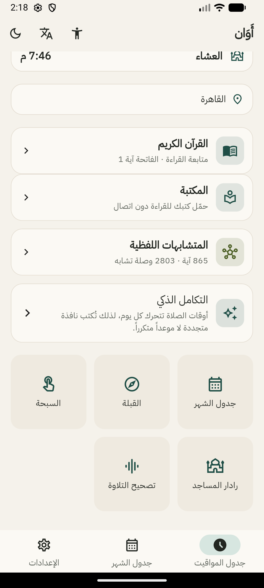
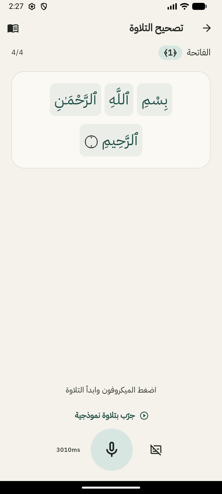
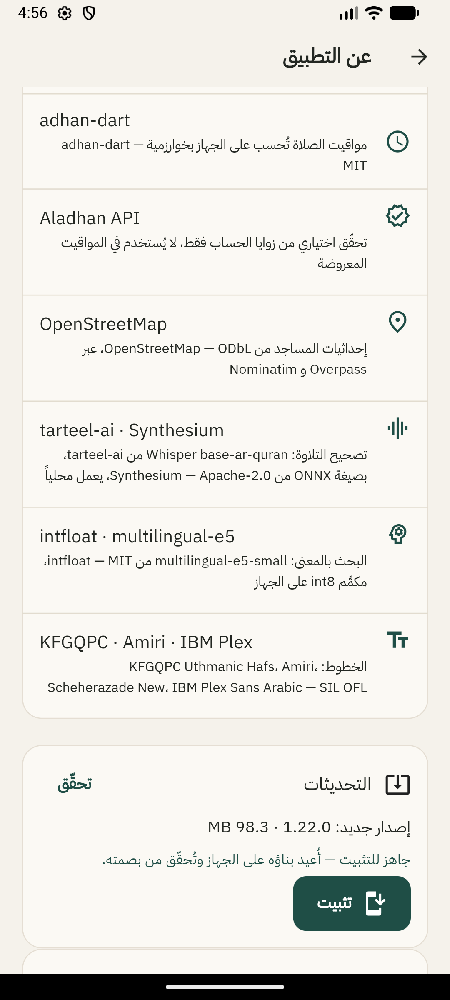
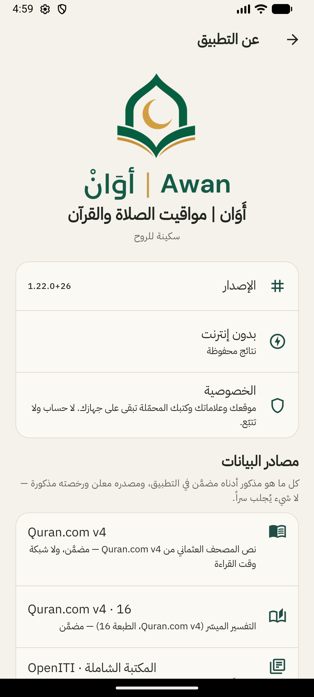

# أَوَان · Awan

**تطبيق إسلامي شامل يعمل دون إنترنت — بلا إعلانات، بلا حساب، بلا تتبّع.**
**A complete offline Islamic app — no ads, no account, no tracking.**

---

## 🌙 بالعربية

### ما هو أَوَان؟

**أَوَان** تطبيق إسلامي متكامل للأندرويد، مبني على مبدأ واحد: **كل شيء يعمل على جهازك**.
لا خادم يرى صلاتك، ولا حساب يربط تلاوتك باسمك، ولا إعلان يقطع أذكارك. تفتح
التطبيق في الطائرة، في المسجد، في مكان بلا شبكة — وكل شيء يعمل.

> 🚧 **المشروع تحت التطوير.** الإصدارات المنشورة صالحة للاستخدام اليومي، لكن
> المزايا تُضاف وتُصقل باستمرار، وقد تتغيّر بعض الواجهات بين إصدار وآخر.

### المزايا

| الميزة | التفصيل |
|---|---|
| 🕌 **مواقيت الصلاة والأذان** | حساب فلكي دقيق على الجهاز (بلا إنترنت)، أذان كامل، عدّاد للصلاة القادمة، وتقويم شهري |
| 📖 **المصحف والتفسير** | نص عثماني بخط QPC، تفسير ميسّر، تنقّل بالسورة والآية، ووضع قارئ مريح للعين |
| 📚 **مكتبة الشاملة** | كتب إسلامية كاملة تعمل دون اتصال، ببحث داخلي سريع |
| 🎙️ **تصحيح التلاوة** | يستمع لتلاوتك ويقارنها بنص الآية كلمةً بكلمة، **على الجهاز نفسه** — الصوت لا يغادر الهاتف أبداً |
| 🕸️ **الرسم المعرفي للمتشابهات** | خرائط بصرية للآيات المتشابهة (الكسائي)، ٨٦٥ آية و٢٨٠٣ وصلة |
| 🔎 **البحث الدلالي** | بحث بالمعنى لا بالحرف، بمحرّك تضمين يعمل محلياً دون إنترنت |
| 🧭 **القبلة ورادار المساجد** | بوصلة قبلة دقيقة، ورادار لأقرب المساجد حولك |
| 📿 **الأذكار والتسبيح** | أذكار الصباح والمساء، مسبحة رقمية، وأدعية |
| 🔔 **الصامت الذكي** | يرفع الصامت للأذان ثم يُعيده كما كان — ولا يلمس الصامت إن أوقفته أنت بيدك |
| ♿ **وضع كبار السن** | خطوط أكبر وواجهة أبسط، بلا تعقيد |

### الخصوصية — بالتفصيل الذي يستحقه الأمر

- **لا حساب، لا تسجيل، لا بريد.** تفتح التطبيق وتستخدمه.
- **لا إعلانات ولا تحليلات ولا تتبّع** — لا Google Analytics، ولا Facebook SDK، ولا Firebase.
- **تسجيل التلاوة لا يُرفع ولا يُحفظ:** يُعالَج في الذاكرة على الجهاز ثم يُنسى.
- **لا يعمل في الخلفية بلا إذنك** ولا يستهلك البطارية: لا فحص دوري ولا خدمات خفية.
- **الشبكة تُستخدم في حالتين فقط:** عند ضغطك على «تنزيل المحرك» لأول مرة، وعند ضغطك على «تحقّق من التحديث». غير ذلك، التطبيق صامت تماماً.
- **التحديث ذاتي ومباشر من GitHub** — بلا متجر، بلا طرف ثالث، وبتحقّق SHA-256 قبل التثبيت.

### التحديث المصغّر (Delta Updates)

التطبيق لا يعيد تنزيل ٩٣ ميجابايت في كل تحديث. ينزّل **ملف فرق صغيراً**، ويعيد
بناء الـAPK على الهاتف من النسخة المثبَّتة، ثم يتحقّق من بصمة SHA-256 قبل تسليمه
لمُثبِّت أندرويد:

| من → إلى | الحجم المنزَّل |
|---|---|
| ١.٢١.٠ → ١.٢٢.٠ | **٠.٦ م.ب** بدل ٩٨ م.ب |
| ١.١٩.١ → ١.٢٢.٠ | **١١.٣ م.ب** بدل ٩٨ م.ب |

بلا متجر، بلا خادم وسيط، وبلا أي خدمة خارجية.

### التنزيل والتركيب

1. افتح [**أحدث إصدار**](https://github.com/omaryounesEG/awan-/releases/latest).
2. نزّل `Awan_v<الإصدار>-arm64-v8a.apk`.
3. اسمح بالتثبيت من هذا المصدر، ثم ثبّت.
4. عند ظهور **Play Protect** اختر «Scan app» ثم «Install» — هذا طبيعي لأي تطبيق من خارج المتجر.

> الحجم ≈ ٩٣ م.ب (arm64). محرك التلاوة (١٦٠ م.ب) يُنزَّل مرة واحدة عند أول استخدام
> لتصحيح التلاوة، ثم يعمل دون إنترنت للأبد.

### التقنيات

`Flutter` · `Dart` · `ONNX Runtime` · `sherpa-onnx` · `Whisper` (على الجهاز) · `Isar` · `SQLite` · `Material 3` · واجهة عربية RTL وإنجليزية LTR كاملتان

### حالة المشروع وخارطة الطريق

- [x] مواقيت الصلاة، الأذان، القبلة، رادار المساجد
- [x] المصحف، التفسير، مكتبة الشاملة
- [x] الرسم المعرفي للمتشابهات، البحث الدلالي
- [x] تصحيح التلاوة على الجهاز
- [x] تحديث ذاتي عبر GitHub Releases + تحديث مصغّر
- [ ] نسخة iOS
- [ ] وضع السيارة
- [ ] المزيد من التفاسير والترجمات
- [ ] تحسين الأداء على الأجهزة القديمة

### المساهمة

كل اقتراح وملاحظة مرحّب بها عبر [Issues](https://github.com/omaryounesEG/awan-/issues).
إن وجدت خطأً في نص قرآني أو تفسير أو توقيت صلاة — **أبلغ فوراً**، فهذه ليست
ميزة نضيفها لاحقاً بل خطأ يجب أن يزول.

### الترخيص

هذا المشروع مجاني بالكامل ومفتوح المصدر بترخيص **MIT**.
نصوص القرآن والتفسير والكتب تخضع لتراخيص مصادرها الأصلية، وهي مذكورة داخل
التطبيق في «عن التطبيق ← مصادر البيانات».

---

## 🇬🇧 In English

### What is Awan?

**Awan** is a complete Islamic app for Android built on one rule: **everything runs
on your device**. No server sees your prayers, no account ties your recitation to
your name, no ad interrupts your dhikr. Open it on a plane, in a mosque, anywhere
without a network — and it still works.

> 🚧 **Work in progress.** Published builds are usable daily, but features are
> still being added and polished, and some screens may change between releases.

### Features

| Feature | Detail |
|---|---|
| 🕌 **Prayer times & adhan** | Accurate on-device astronomical calculation (no network), full adhan, next-prayer countdown, monthly timetable |
| 📖 **Quran & tafsir** | Uthmani text in QPC fonts with a mayssar tafsir and comfortable reading mode |
| 📚 **Shamela library** | Full Islamic books available offline with fast in-book search |
| 🎙️ **Recitation correction** | Listens to your recitation and aligns it to the ayah word by word, **entirely on-device** — audio never leaves the phone |
| 🕸️ **Mutashabihat knowledge graph** | Visual maps of similar verses (Al-Kisai): 865 ayat, 2,803 edges |
| 🔎 **Semantic search** | Search by meaning rather than exact string, with a local embedding model |
| 🧭 **Qibla & mosque radar** | Precise qibla compass and a radar of nearby mosques |
| 📿 **Dhikr & tasbih** | Morning/evening adhkar, digital tasbih, duas |
| 🔔 **Smart silent mode** | Restores the ringer for the adhan, then puts it back — and never touches a silent mode you set yourself |
| ♿ **Elderly mode** | Larger text, simpler layout |

### Privacy, precisely

- **No account, no sign-up, no email.**
- **No ads, no analytics, no tracking** — no analytics SDK, no social SDK, no Firebase.
- **Recitation audio is never uploaded or stored:** it is processed in memory on-device and discarded.
- **No background work behind your back:** no periodic checks, no hidden services, no battery drain.
- **The network is used twice, and only when you press a button:** the first-time engine download, and the manual “check for updates”.
- **Updates come directly from GitHub Releases** — no store, no third party, with SHA-256 verification before installation.

### Delta updates

Instead of downloading 93 MB for every fix, the app downloads a small patch,
rebuilds the APK on the phone from the installed build, verifies its SHA-256
against the published one, and only then hands it to Android's installer.
Measured: **0.6 MB** for a routine release, **11.3 MB** when real code changed —
versus 98 MB.

### Install

1. Open the [**latest release**](https://github.com/omaryounesEG/awan-/releases/latest).
2. Download `Awan_v<version>-arm64-v8a.apk`.
3. Allow installs from this source, then install.
4. If Play Protect appears, choose “Scan app” then “Install” — normal for any sideloaded app.

### Tech

`Flutter` · `Dart` · `ONNX Runtime` · `sherpa-onnx` · on-device `Whisper` · `Isar` · `SQLite` · `Material 3` · full Arabic RTL and English LTR

### Status & roadmap

- [x] Prayer times, adhan, qibla, mosque radar
- [x] Quran, tafsir, Shamela library
- [x] Mutashabihat knowledge graph, semantic search
- [x] On-device recitation correction
- [x] Self-update via GitHub Releases + delta patches
- [ ] iOS build
- [ ] Car mode
- [ ] More tafsirs and translations
- [ ] Performance work on older devices

### Contributing

Ideas and bug reports are welcome in [Issues](https://github.com/omaryounesEG/awan-/issues).
If you find an error in Quranic text, tafsir, or a prayer time — **report it
immediately**; that is not a feature to schedule, it is a defect to remove.

### License

Free and open source under the **MIT** license. Quranic text, tafsir and bundled
books remain under their original licenses, listed inside the app under
“About → Data sources”.

---

**الكلمات المفتاحية · Keywords**

تطبيق إسلامي · مواقيت الصلاة · أذان · القرآن الكريم · المصحف · تفسير · المكتبة الشاملة ·
تصحيح التلاوة · تجويد · ذكاء اصطناعي على الجهاز · بدون إنترنت · أوفلاين · القبلة ·
رادار المساجد · أذكار · تسبيح · متشابهات القرآن · بحث دلالي · تقويم هجري · أندرويد ·
آيفون · iOS · خصوصية · بلا إعلانات · مجاني · مفتوح المصدر

Islamic app · prayer times · adhan · Quran · tafsir · offline Quran · recitation
correction · tajweed · on-device AI · Whisper · privacy-first · no ads · no tracking ·
open source · Flutter · Android · iOS · qibla compass · mosque finder · tasbih · hijri calendar

