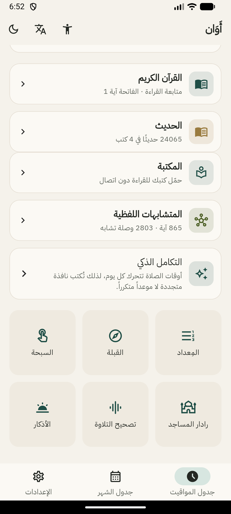
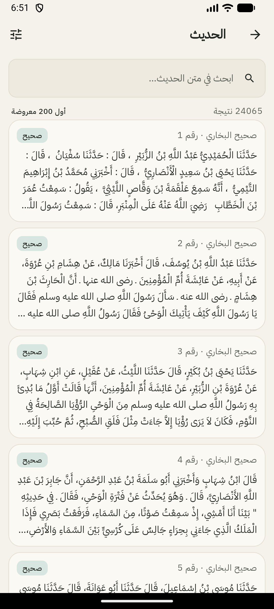
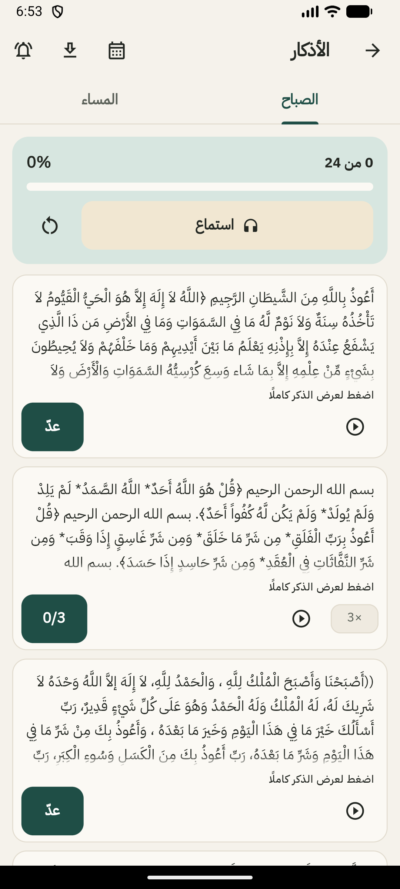

<div align="center">


# أَوَان · Awan

**تطبيق إسلامي شامل يعمل دون إنترنت — بلا إعلانات، بلا حساب، بلا تتبّع.**
**A complete offline Islamic app for Android — no ads, no account, no tracking.**

[](https://github.com/omaryounesEG/awan/releases/latest)
[](https://github.com/omaryounesEG/awan/releases)
[](https://github.com/omaryounesEG/awan/releases)
[](PRIVACY.md)
[](LICENSE)

[العربية](#-بالعربية) · [English](#-english) · [الإصدارات / Releases](https://github.com/omaryounesEG/awan/releases)

</div>

<div align="center">




</div>

---

## 🌙 بالعربية

### ما هو أَوَان؟

**أَوَان** تطبيق إسلامي متكامل للأندرويد، مبني على مبدأ واحد: **كل شيء يعمل على جهازك**.
لا خادم يرى صلاتك، ولا حساب يربط تلاوتك باسمك، ولا إعلان يقطع أذكارك. تفتح
التطبيق في الطائرة، في المسجد، في مكان بلا شبكة — وكل شيء يعمل.

> الإصدار الحالي **v1.27.0** صالح للاستخدام اليومي، والمزايا تُضاف وتُصقل باستمرار.

### المزايا

| | الميزة | التفصيل |
|---|---|---|
| 🕌 | **مواقيت الصلاة** | حساب فلكي على الجهاز من إحداثياتك، بلا إنترنت، مع عدّاد للصلاة القادمة وتقويم شهري |
| 🔔 | **الأذان** | أذان ١ وأذان ٢ وتنبيه ١–٣، وإشعار واحد فقط للصلاة القادمة يُستبدله كل أذان جديد ولا يتراكم |
| 🕌 | **تكبيرات العيد** | تلقائيًا قبل شروق يومَي الفطر والأضحى بخمس وعشرين دقيقة، بصوت التكبيرات — دون أي ضبط يدوي |
| 🤫 | **الصامت الذكي** | يصمت الهاتف وقت الصلاة والجمعة فقط، ومقيَّد بنطاق المسجد المسجَّل — ولا يرفع الصامت اليدوي أبدًا |
| 📿 | **الأذكار** | أذكار الصباح والمساء بالعربية والإنجليزية كواجب يومي: عدّاد لكل ذكر، نسبة إنجاز، تقرير شهري، تذكير، واستماع مع **وضع السيارة** |
| 📖 | **المصحف والتفسير** | نص عثماني بخطوط QPC حفص، تفسير ميسّر، تنقّل بالسور والأجزاء، وحفظ موضع القراءة |
| 📜 | **الحديث** | **٣٦٬٠٣٨ حديثًا** من سبعة كتب: البخاري، مسلم، أبو داود، الترمذي، النسائي، ابن ماجه، وموطأ مالك — بحث يتجاهل التشكيل والهمزات، فلاتر للكتاب والدرجة والباب، و**تخريج** يربط نفس المتن في الكتب الأخرى (2,759 رابطًا) |
| 🔬 | **أدوات الباحث** | قسم فرعي لمن يعمل بالحديث: بحث في المتون مع بيان الكتب التي روت المتن نفسه، وفهرس **٢٣٬٦٥٤ راويًا** بالدرجة وسنة الوفاة |
| 🧩 | **المتشابهات اللفظية** | رسم معرفي لـ **٨٦٥ آية** و**٢٬٨٠٣ وصلة** تشابه، مع طبقات للتشابه التام والتقارب |
| 🔎 | **البحث الدلالي** | بحث بالمعنى لا بالحرف، بمحرّك تضمين يعمل محليًا دون إنترنت |
| 🎙️ | **تصحيح التلاوة** | يستمع لتلاوتك ويقارنها بنص الآية كلمةً بكلمة، **على الجهاز نفسه** — الصوت لا يغادر الهاتف |
| 📚 | **المكتبة** | كتب إسلامية تُنزَّل مرة واحدة وتُقرأ دون اتصال، ببحث داخلي سريع |
| 🧮 | **المِعداد** | مختبر إحصاءات النص القرآني: عدد الكلمات والحروف والتكرارات، مقترنة باصطلاحها وبلا لغة «إعجاز عددي» |
| 🧭 | **القبلة ورادار المساجد** | بوصلة قبلة دقيقة، ورادار لأقرب المساجد حولك دون خدمة خرائط تجارية |
| 🌗 | **عربي وإنجليزي** | واجهتان كاملتان RTL/LTR، وضع ليلي، و**وضع كبار السن** بتكبير ١٥٠٪ |
| 🔄 | **تحديث ذاتي مصغّر** | مفتاح تحديث داخل التطبيق مربوط بـ GitHub Releases — بلا Firebase ولا متجر، وبتحقّق SHA-256 قبل التثبيت |

### التحميل والتركيب

| الملف | الحجم | ملاحظة |
|---|---|---|
| [Awan_v1.27.0-arm64-v8a.apk](https://github.com/omaryounesEG/awan/releases/download/v1.27.0/Awan_v1.27.0-arm64-v8a.apk) | ١٠٣٫٨ م.ب | **الأكثر شيوعًا** — هواتف أندرويد الحديثة |
| [Awan_v1.27.0-armeabi-v7a.apk](https://github.com/omaryounesEG/awan/releases/download/v1.27.0/Awan_v1.27.0-armeabi-v7a.apk) | ٩٢٫٩ م.ب | أجهزة قديمة (٣٢-بت) |
| [1.26.0__1.27.0.patch](https://github.com/omaryounesEG/awan/releases/download/v1.27.0/1.26.0__1.27.0.patch) | ٨٫٠ م.ب | ترقية مصغّرة لمن لديه 1.26.0 |
| [SHA256SUMS](https://github.com/omaryounesEG/awan/releases/download/v1.27.0/SHA256SUMS) | ٢٩٠ ب | بصمات التحقّق |

1. افتح [**أحدث إصدار**](https://github.com/omaryounesEG/awan/releases/latest).
2. نزّل `arm64-v8a` لأغلب الأجهزة، أو `armeabi-v7a` للأجهزة الأقدم.
3. اسمح بالتثبيت من هذا المصدر، ثم ثبّت.
4. عند ظهور **Play Protect** اختر «Scan app» ثم «Install» — هذا طبيعي لأي تطبيق من خارج المتجر.

> محرك التلاوة (~١٦٠ م.ب) يُنزَّل مرة واحدة عند أول استخدام لتصحيح التلاوة، ثم يعمل دون إنترنت.
> صوت الأذكار (٢٤ ملفًا، ١٣ م.ب) يُنزَّل من داخل شاشة الأذكار عند الطلب.

### الخصوصية — بالتفصيل الذي يستحقه الأمر

- **لا حساب، لا تسجيل، لا بريد.** تفتح التطبيق وتستخدمه.
- **لا إعلانات ولا تحليلات ولا تتبّع** — لا Google Analytics، ولا Facebook SDK، ولا Firebase.
- **تسجيل التلاوة لا يُرفع ولا يُحفظ:** يُعالَج في الذاكرة على الجهاز ثم يُنسى.
- **الموقع يُقرأ على الجهاز** لحساب المواقيت والقبلة ونطاق المسجد، ولا يُرسَل إلى أي خادم.
- **لا يعمل في الخلفية بلا إذنك:** لا فحص دوري ولا خدمات خفية.
- **الشبكة تُستخدم عند طلبك فقط:** تنزيل محرك التلاوة، صوت الأذكار، كتب المكتبة، وفحص التحديث.
- **التحديث ذاتي ومباشر من GitHub** — بلا متجر ولا طرف ثالث، وبتحقّق SHA-256 قبل التثبيت.

### التحديث المصغّر (Delta Updates)

التطبيق لا يعيد تنزيل ١٠٠ ميجابايت في كل تحديث. ينزّل **ملف فرق صغيرًا**، ويعيد بناء
الـAPK على الهاتف من النسخة المثبَّتة، ثم يتحقّق من بصمة SHA-256 قبل تسليمه لمُثبِّت أندرويد:

| من → إلى | الحجم المنزَّل |
|---|---|
| 1.24.1 → 1.25.0 | **٨٫٥ م.ب** بدل ١٠٢ م.ب |
| 1.24.0 → 1.24.1 | **٧٫١ م.ب** |
| 1.21.0 → 1.22.0 | **٠٫٦ م.ب** |

### المصادر

- **نص المصحف:** رسم عثماني، وخطوط QPC حفص بترخيصها.
- **الحديث:** [AhmedBaset/hadith-json](https://github.com/AhmedBaset/hadith-json) — البخاري، مسلم، أبو داود، الترمذي.
- **الأذكار:** [hisnmuslim.com](https://hisnmuslim.com) — النصوص والأصوات.
- **رجال الحديث:** جدول رواة مشروع Hadith_RAG (الاسم العربي والدرجة والوفاة).
- **المتشابهات:** فهرسة داخل المشروع على نص المصحف.
- الشكر لكل من أتاح هذه المواد للاستخدام العام.

### التقنيات

`Flutter` · `Dart` · `ONNX Runtime` · `sherpa-onnx` · `Whisper` على الجهاز · `Isar` · `SQLite` · `Material 3` · واجهة عربية RTL وإنجليزية LTR كاملتان

### حالة المشروع

- [x] مواقيت الصلاة، الأذان، القبلة، رادار المساجد، الصامت الذكي
- [x] المصحف، التفسير، المكتبة، المتشابهات، البحث الدلالي
- [x] تصحيح التلاوة على الجهاز، المِعداد
- [x] الأذكار (نصوص + صوت + تقرير شهري + وضع السيارة)
- [x] الحديث: ٣٦٬٠٣٨ حديثًا في سبعة كتب، ببحث وفلاتر وتخريج، وأدوات الباحث (المتون + ٢٣٬٦٥٤ راويًا)
- [x] تحديث ذاتي عبر GitHub Releases + تحديث مصغّر
- [ ] كتب الحديث الـ١٧ كاملة (السبعة الآن)
- [ ] نسخة iOS
- [ ] المزيد من التفاسير والترجمات

### المساهمة

كل اقتراح وملاحظة مرحّب بها عبر [Issues](https://github.com/omaryounesEG/awan/issues).
إن وجدت خطأً في نص قرآني أو حديث أو توقيت صلاة — **أبلغ فورًا**، فهذه ليست ميزة نضيفها لاحقًا بل خطأ يجب أن يزول.

### الترخيص

هذا المشروع مجاني ومفتوح المصدر بترخيص **MIT**. نصوص القرآن والحديث والكتب تخضع
لتراخيص مصادرها الأصلية، وهي مذكورة داخل التطبيق في «عن التطبيق ← مصادر البيانات».

---

## 🇬🇧 English

### What is Awan?

**Awan** is a complete Islamic app for Android built on one rule: **everything runs
on your device**. No server watching your prayers, no account tying your recitation to
your name, no ad between you and your adhkar. Open it on a plane, in a mosque, in a place
with no signal — and it works.

> Current release **v1.27.0** is usable daily; features are added and polished constantly.

### Features

| | Feature | Detail |
|---|---|---|
| 🕌 | **Prayer times** | On-device astronomical calculation from your coordinates, next-prayer countdown, monthly timetable |
| 🔔 | **Adhan** | Adhan 1, Adhan 2 and alerts 1–3; exactly one upcoming-prayer notification, replaced by the next adhan instead of stacking |
| 🕌 | **Eid takbir** | Automatically twenty-five minutes before sunrise on both Eids, using the takbir clip — no setup |
| 🤫 | **Smart silence** | Silences the phone only at prayer and Friday prayer, only inside the registered mosque fence — never overrides a manual silent |
| 📿 | **Adhkar** | Morning and evening remembrances in Arabic and English as a daily task: per-thikr counter, progress, monthly report, reminder, listening and a **car mode** |
| 📖 | **Qur'an & tafsir** | Uthmani text in QPC Hafs fonts, a concise tafsir, surah/juz navigation, saved reading position |
| 📜 | **Hadith** | **36,038 narrations** from seven books: Bukhari, Muslim, Abu Dawud, Tirmidhi, an-Nasa'i, Ibn Majah and Muwatta Malik — diacritics-insensitive search, filters by book/grade/chapter, and takhrij linking the same matn across books (2,759 links) |
| 🔬 | **Researcher tools** | A sub-section for people who work with hadith: matn search showing which books narrate the same matn, and an index of **23,654 narrators** with grade and death year |
| 🧩 | **Mutashabihat** | A knowledge graph of **865 verses** and **2,803** textual-similarity links, layered by exact and near similarity |
| 🔎 | **Semantic search** | Search the Qur'an by meaning with a local embedding model, offline |
| 🎙️ | **Recitation check** | Listens to your recitation and aligns it to the ayah word by word, **entirely on-device** — audio never leaves the phone |
| 📚 | **Library** | Islamic books downloaded once, then read offline with fast in-book search |
| 🧮 | **Al-Mi'dad** | A Qur'anic text-statistics lab: words, letters, frequencies, tied to a stated convention — no numerological claims |
| 🧭 | **Qibla & mosque radar** | A sensor-based qibla compass and a radar of nearby mosques without a commercial maps service |
| 🌗 | **Arabic & English** | Two complete RTL/LTR interfaces, dark mode and an **elderly mode** at 150% scale |
| 🔄 | **Self-update** | An in-app update check wired to GitHub Releases — no Firebase, no store, SHA-256 verified |

### Download & install

| File | Size | Note |
|---|---|---|
| [Awan_v1.27.0-arm64-v8a.apk](https://github.com/omaryounesEG/awan/releases/download/v1.27.0/Awan_v1.27.0-arm64-v8a.apk) | 103.8 MB | **Most common** — modern Android phones |
| [Awan_v1.27.0-armeabi-v7a.apk](https://github.com/omaryounesEG/awan/releases/download/v1.27.0/Awan_v1.27.0-armeabi-v7a.apk) | 92.9 MB | Older 32-bit devices |
| [1.26.0__1.27.0.patch](https://github.com/omaryounesEG/awan/releases/download/v1.27.0/1.26.0__1.27.0.patch) | 8.0 MB | Delta patch from 1.26.0 |
| [SHA256SUMS](https://github.com/omaryounesEG/awan/releases/download/v1.27.0/SHA256SUMS) | 290 B | Checksums |

Open the [latest release](https://github.com/omaryounesEG/awan/releases/latest), download
the APK for your device, allow installs from this source, and install. If Play Protect
appears, choose “Scan app” then “Install” — normal for any sideloaded app.

> The recitation engine (~160 MB) downloads once on first use, then runs offline.
> Adhkar audio (24 files, 13 MB) downloads from inside the adhkar screen on request.

### Privacy, precisely

- **No account, no sign-up, no email.**
- **No ads, no analytics, no tracking** — no analytics SDK, no social SDK, no Firebase.
- **Recitation audio is never uploaded or stored:** processed in memory on-device and discarded.
- **Location is read on-device** for prayer times, qibla and the mosque fence; it is never sent anywhere.
- **No background work behind your back:** no periodic checks, no hidden services.
- **The network is used only when you press something:** engine download, adhkar audio, library books, update check.
- **Updates come directly from GitHub Releases** with SHA-256 verification before install.

### Delta updates

Instead of downloading 100 MB for every fix, the app downloads a small patch, rebuilds the
APK on the phone from the installed build, verifies its SHA-256, and only then hands it to
Android's installer. Measured: **8.5 MB** for v1.25.0, **7.1 MB** for v1.24.1, **0.6 MB**
for a routine release.

### Sources

- **Qur'an:** Uthmani text, QPC Hafs fonts under their own licence.
- **Hadith:** [AhmedBaset/hadith-json](https://github.com/AhmedBaset/hadith-json).
- **Adhkar:** [hisnmuslim.com](https://hisnmuslim.com) — texts and audio.
- **Mutashabihat:** indexed in-project against the Qur'anic text.

### Tech

`Flutter` · `Dart` · `ONNX Runtime` · `sherpa-onnx` · on-device `Whisper` · `Isar` · `SQLite` · `Material 3` · full Arabic RTL and English LTR

### Build

```bash
git clone https://github.com/omaryounesEG/awan.git
cd awan
flutter pub get
flutter build apk --release --split-per-abi
```

Flutter 3.x and JDK 17. To regenerate the hadith asset:

```bash
python tools/build_hadith_asset.py --source <hadith-json books dir> --out assets/hadith
```

### Status & roadmap

- [x] Prayer times, adhan, qibla, mosque radar, smart silence
- [x] Qur'an, tafsir, library, mutashabihat, semantic search
- [x] On-device recitation check, Al-Mi'dad
- [x] Adhkar (text, audio, monthly report, car mode)
- [x] Hadith: 36,038 narrations in seven books, with search, filters, takhrij and researcher tools (matns + 23,654 narrators)
- [x] Self-update via GitHub Releases + delta patches
- [ ] All 17 hadith books (seven today)
- [ ] iOS build
- [ ] More tafsirs and translations

### Contributing

Ideas and bug reports are welcome in [Issues](https://github.com/omaryounesEG/awan/issues).
If you find an error in Qur'anic text, a hadith, or a prayer time — **report it
immediately**; that is not a feature to schedule, it is a defect to remove.

### License

Free and open source under the **MIT** license. Qur'anic text, hadith and bundled books
remain under their original licenses, listed inside the app under “About → Data sources”.

---

## 🔎 الكلمات المفتاحية · Keywords

`تطبيق إسلامي` · `مواقيت الصلاة` · `أذان` · `المصحف` · `القرآن الكريم` · `تفسير` ·
`الحديث الشريف` · `صحيح البخاري` · `صحيح مسلم` · `سنن أبي داود` · `جامع الترمذي` ·
`تخريج الحديث` · `الأذكار` · `أذكار الصباح والمساء` · `المتشابهات اللفظية` ·
`تصحيح التلاوة` · `تجويد` · `القبلة` · `رادار المساجد` · `التقويم الهجري` ·
`المكتبة الشاملة` · `بحث دلالي` · `تطبيق بلا إنترنت` · `بلا إعلانات` · `مفتوح المصدر`

`islamic app` · `quran app` · `prayer times` · `adhan` · `athan` · `hadith` ·
`hadith search` · `sahih bukhari` · `sahih muslim` · `sunan abu dawud` ·
`jami at-tirmidhi` · `takhrij` · `adhkar` · `morning and evening adhkar` ·
`mutashabihat` · `qibla` · `mosque finder` · `hijri calendar` · `offline quran` ·
`recitation correction` · `on-device AI` · `flutter` · `dart` · `android` ·
`privacy-first` · `no ads` · `no tracking` · `open source`

---

<div align="center">

**صُنع بعناية لمن يقرأ ويصلّي — Made for people who read and pray.**

[](https://github.com/omaryounesEG/awan/stargazers)

</div>
